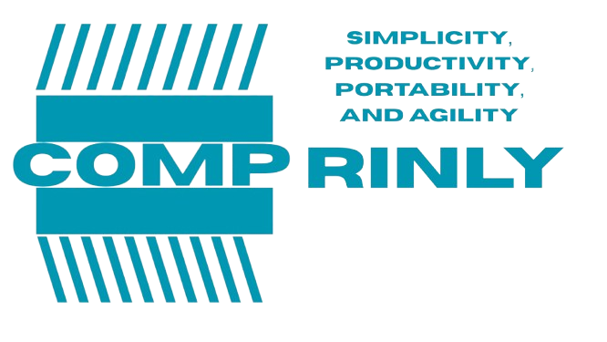

  

# Comprinly

Comprinly (`cly`) is a mature, feature-packed programming language and a dependable tool with almost the same syntax as NASM. It is simple, optimized, portable and fast... hence the slogan.

It reads x86, ARM64 and RISC-V from the same syntax. The commands you type do not change when the CPU does.

## Project status

Comprinly is no longer an experiment, I am fully working on it and hoping for collaborators.

From 1.3.0 on, the project is no longer fully vibe-coded. It is partly vibe-coded and partly written by hand by me and, hopefully, by the people who join. See [CONTRIBUTING.md](CONTRIBUTING.md) if you want to help.

Version 1.3.5 adds shared libraries (`.so`) and Windows DLLs, and it is the first release where Comprinly can link its own programs against libc, against libraries built by gcc, and into libraries that gcc programs load. It was hunted for bugs hard: every release is checked by three sets of batched tests (500, 500 and 1600) that link and run programs on four CPU families, compare thousands of random instructions against NASM, link random C programs and compare the result with GNU ld, and feed broken files to the assembler and the linker. Bugs can still exist, so please keep reporting them.

## Get it

Prebuilt binaries are on the [Releases page](https://github.com/rhyelt/Comprinly/releases). Or build it yourself. You only need a C compiler and make:

    make

That gives you a `cly` file in the same folder. `make install` copies it to `/usr/local/bin`.

## Your first program

Save this as `hello.cly`:

    msg db "Hello, World!", 10

    start:
        mov rax, 1
        mov rdi, 1
        mov rsi, msg
        mov rdx, $ - msg
        syscall

        mov rax, 60
        mov rdi, 0
        syscall

Build and run it:

    cly linux hello.cly
    cly linux32 hello.cly
    ./hello

The finished file is written next to the source file.

## The command

    cly <system> <file> [options]

The system is one of `linux`, `windows`, `mac` or `bare`. A few examples:

    cly linux hello.cly
    cly windows hello.cly
    cly bare hello.cly -hex
    cly linux hello.cly -O0
    cly linux hello.cly -O3
    cly linux hello.cly -cpu i386
    cly hello.cly
    cly hello.cly -o
    cly hello.cly -obj
    cly hello.cly --o hello.o
    cly hello.o --ld hello
    cly linux lib.cly -shared --o libx.so
    cly linux main.cly -dynamic -needed ./libx.so
    cly windows lib.cly -dll

Run `cly -h` to see every option.

## Benchmarks

Comprinly against C and NASM on speed, size and behavior. Hello World is 162 bytes. See [BENCHMARKS.md](BENCHMARKS.md) for the numbers, and how they were taken.

## Choosing a CPU

Comprinly decides the CPU in this order:

1. The `-cpu` option, for example `cly linux hello.cly -cpu arm64`
2. A `cpu` line at the very top of the file
3. The first instruction or register in your code that belongs to only one CPU
4. x86-64, if nothing gives it away

The `cpu` line looks like this:

    cpu arm64
    cpu x86-64
    cpu risc-v

If your code mixes CPUs, say `mov eax, 1` in a file that started out as ARM64, Comprinly stops and tells you which line it based its choice on.

## When something goes wrong

Errors name the file, the line, the code and what is wrong, and often suggest a fix. Warnings do not stop the build. `-w` hides them and `-q` hides everything but errors.

## Where to go next

- `HOWTOUSE.md` walks through the whole compiler, one topic at a time.
- `DOCUMENTATION.md` is the reference for directives, the preprocessor and each CPU.
- `examples/` has small programs to try.
- `CHANGELOG.md` lists what changed in each version.

## Tests

    make check

runs everything it has tools for and skips the rest.

## Licence

AGPL-3.0. The NASM instruction table keeps its own BSD notice.
